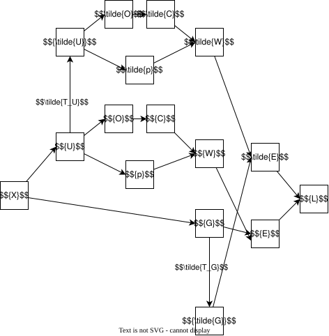

$\DeclareMathOperator*{\argmax}{arg\,max}
\DeclareMathOperator*{\argmin}{arg\,min}
\DeclareMathOperator{\diag}{diag}
\DeclareMathOperator{\vec}{vec}
\newcommand{\norm}[1]{\left\lVert #1 \right\rVert}
$
$\newcommand{\dproduct}[2]{\left\langle #1, #2\right\rangle}
$

# Numbers

- $M$: total number of features
      <!-- - $M'$: total number of features after PCA -->
- $s$: number of feature sets
      <!-- - $\tilde{s}$: number of feature sets kept -->
- $M_i$: number of features in set $i$: $M = \displaystyle\sum_{i=1}^{s} M_i$
      <!-- - $M_i'$: number of features in set $i$ after PCA: $M' = \displaystyle\sum_{i=1}^{s} M_i'$ -->
- $N$: number of inputs
- $W$: number of windows per input
- $\tilde{M}$: number of features kept: $\tilde{M} = \displaystyle\sum_{i \in J} M_i$
      <!-- - $K$: number of clusters -->
- $K_i$: number of clusters kept after filter for feature set $i$
- $K'$: number of clusters kept after filter: $K' = \displaystyle\sum_{i=1}^{s} K_i$
- $\tilde{K}$: number of clusters kept after filter for feature sets kept: $\tilde{K} = \displaystyle\sum_{i \in J} K_i$
- $D_i$: dimensionality of WMF for feature set $i$
- $D_{total}$: dimensionality of WMF for $QF_{total}$
- $\tilde{D}$: dimensionality of the embedding before final PCA (after QF, G1 and $QF_{total}$): $\tilde{D}=\displaystyle\sum_{i=1}^{s} (D_i + 2M_i) + D_{total}$
- $D'$: final dimension of the embeddings

# Indices

- $i \in [\![1,s]\!]$: index for feature sets. can also be $total$ to refer to $QF_{total}$
- $j \in [\![1,M]\!]$: index for features
- $j_i \in [\![1,M_i]\!]$: index for features inside set $i$
      <!-- - $j_i' \in [\![1,M_i']\!]$: index for features inside set $i$ after QF PCA -->
- $w \in [\![1,W]\!]$: index for windows
- $n \in [\![1,N]\!]$: index for inputs
      <!-- - $k \in [\![1,K]\!]$: index for clusters -->
- $k_i \in [\![1,K_i]\!]$: index for clusters of feature set $i$ after filter
- $d_i \in [\![1,D_i]\!]$: index for dimension of WMF embedding of feature set $i$
- $d_i' \in [\![1,D_i + 2M_i]\!]$: index for dimension of block after concatenation of QF and G1 modules of feature set $i$
- $d_{total} \in [\![1,D_{total}]\!]$: index for dimension of WMF embedding of $QF_{total}$
- $\tilde{d} \in [\![1,\tilde{D}]\!]$: index for dimension of the embedding before the final PCA
- $d' \in [\![1,D']\!]$: index for dimension of the final embedding

- $\tilde{J}\subseteq [\![1,s]\!]$: indices of feature sets to keep

# Data

- $X=(X_j)_{j} = (X_{i, j_i})_{i, j_i}$: feature data for one input and one window. Bold for matrices
- $(X^{(w)})_w$: feature data for each window
- $(X^{(n)})_n$: feature data for each input

# Functions

<!-- - $f = f_{task} \circ f_{QFM}$ -->
<!-- - G1:
    $$
      	\begin{array}{r@{\;}|l}
      f_{\mu, i}: &
    \begin{aligned}
     \mathbb{R}^{N \times M_i \times W} &\longrightarrow \mathbb{R}^{N \times M_i}\\
              (X^{(n, w)}_{i, j_i})_{n, j_i,w} &\longmapsto
               \left(\displaystyle\frac{1}{W}\sum_w X_{i, j_i}^{(n, w)}\right)_{n, j_i}
    		   \end{aligned}
      \end{array}
      \\
      \begin{array}{r@{\;}|l}
      f_{\sigma, i}: &
    \begin{aligned}
     \mathbb{R}^{N \times M_i \times W} &\longrightarrow \mathbb{R}^{N \times M_i}\\
              (X^{(n, w)}_{i, j_i})_{n, j_i,w} &\longmapsto
               \left(\displaystyle \sqrt{\frac{1}{W-1}\sum_w\left(X_{i, j_i}^{(n, w)}-f_\mu\left(\left(X^{(n, w')}_{i, j_i}\right)_{n, j, w'}\right)\right)^2}\right)_{n, j_i}
    		   \end{aligned}
      \end{array}
      \\
      f_{G1, i}=(f_{\mu, i}, f_{\sigma, i})
    $$
- Standard scaler:

    $$
      	\begin{array}{r@{\;}|l}
      f_{SS}: &
    \begin{aligned} \mathbb{R}^{N \times M \times W} &\longrightarrow\mathbb{R}^{N \times M \times W} \\
              (X^{(n, w)}_j)_{n,j,w} &\longmapsto
               \left(\displaystyle\frac{X^{(n, w)}_j - \mu_j}{\sigma_j}\right)_{n, j, w}
    		   \end{aligned}
      \end{array}
    $$

- QF PCA:

    $$
      	\begin{array}{r@{\;}|l}
      f_{QFPCA, i}: &
    \begin{aligned}
    \mathbb{R}^{N \times M_i \times W} &\longrightarrow\mathbb{R}^{N \times M_i' \times W} \\
              {X_i}=(X^{(n, w)}_{i, j_i})_{n, j_i, w} &\longmapsto
               {\mathscr{l}_i^{-1/2}R_i^{T}}({X_i - \bar{X_i}})
    		   \end{aligned}
      \end{array}\\
    $$

    with the first ($N$) and third ($W$) axes of $X$ flattened into one for the matrix multiplication

    $$
        f_{QFPCA} = (f_{QFPCA, i})_i
    $$

- K-Means:

    $$
      	\begin{array}{r@{\;}|l}
      f_{Kmeans}: &
    \begin{aligned}
     \mathbb{R}^{N \times M' \times W} &\longrightarrow {[\![1,K]\!]}^{s \times N \times W} \\
              (X^{(n, w)}_{i, j_i'})_{n, i, j_i', w} &\longmapsto
               \left(\displaystyle\argmin_{k} \norm{(X^{(n, w)}_{i, j_i'})_{j_i'} - m_{i,k}}^2 \right)_{i, n, w}
    		   \end{aligned}
      \end{array}\\
    $$

- Unigram (K-Means):

    $$
      	\begin{array}{r@{\;}|l}
      f_{Unigram}: &
    \begin{aligned}
    {[\![1,K]\!]}^{s \times N \times W} &\longrightarrow \mathbb{R}^{s \times N \times K} \\
              (r_{i}^{(n, w)})_{i, n, w} &\longmapsto
               \left(\displaystyle \sum_w\mathbb{1}_{r_{i}^{(n, w)} = k} \right)_{i, n, k}
    		   \end{aligned}
      \end{array}\\
    $$

    Columns with low presence are discarded, we keep $K_i$ columns for each set -->

- WMF:

    $$
          	\begin{array}{r@{\;}|l}
          f_{WMF, i}: &
    	  \begin{aligned}
    	   \mathbb{R}^{N \times K_i} &\longrightarrow \mathbb{R}^{N \times D_i} \\
                  (U^{(n)}_{i, k_i})_{n, k_i} &\longmapsto \left((V_i^T C_i^{(n)}V_i + \lambda I_{D_i})^{-1}V_i^T C_i^{(n)}p_i^{(n)}\right)_n
    			 \end{aligned}
          \end{array}\\
    $$

    with

    $$
    	C_i^{(n)}= \diag\left(O_i^{(n)}\right)
      \\
      O_i^{(n)} = \left(1+\alpha U_{i, k_i}^{(n)}\right)_{k_i}
    	\\
    	p_i^{(n)} = \left(\mathbb{1}_{U_{i, k_i}^{(n)}>0}\right)_{k_i}
    $$

    For $i=total$, $K_{total} = \displaystyle \sum_{i=1}^{s}K_i$ and unigrams are flattened along the first ($s$) and third ($K_i$) axes

- Robust scaler:

    $$
      	\begin{array}{r@{\;}|l}
      f_{RS}: & \begin{aligned}
    \mathbb{R}^{N \times \tilde{D}} &\longrightarrow\mathbb{R}^{N \times \tilde{D}} \\
              Z=(Z^{(n)}_{\tilde{d}})_{n, \tilde{d}} &\longmapsto
               \left(\displaystyle\frac{Z^{(n)}_{\tilde{d}} - Median_{\tilde{d}}}{IQR_{\tilde{d}}}\right)_{n, \tilde{d}} \\ &= (Z - 1_N \left((Median_{\tilde{d}})_{\tilde{d}}\right)^T) IQR^{-1}
    		   \end{aligned}
      \end{array}

    $$

    where $IQR^{-1} = \diag\left(\displaystyle\left(\frac{1}{IQR_{\tilde{d}}}\right)_{\tilde{d}}\right)$

- Final PCA:

    $$
      	\begin{array}{r@{\;}|l}
      f_{PCA}: & \begin{aligned}
    \mathbb{R}^{N \times \tilde{D}} &\longrightarrow\mathbb{R}^{N \times D'} \\
              {Z}=(Z^{(n)}_{\tilde{d}})_{n, \tilde{d}} &\longmapsto
               \displaystyle{ZR}
    		   \end{aligned}
      \end{array}\\
    $$

- QFM encoder:

    $$
    	(E^{(n)}_{d'})_{n, d'} = f_{PCA} \circ f_{RS} \left(\left(\left(W^{(n)}_{i}\right)_{i}, \, \left(W_{d_{total}, total}^{(n)}\right)_{d_{total}}, \left(G_i^{(n)}\right)_{i}\right)_n\right)
    	\\
      \left(W_i^{(n)}\right)_{i, n} = \left(f_{WMF, i}\left((U^{(n)}_{i, k_i})_{n, k_i}\right)\right)_i
      \\
    	\left(W_{d_{total}, total}^{(n)}\right)_{n, d_{total}} = f_{WMF, total}\left((U^{(n)}_{i, k_i})_{i, n, k_i}\right)
    	\\
      \left(G_i^{(n)}\right)_{i, n} = \left(f_{G1, i}\left(\left(X_{j_i}^{(n, w)}\right)_{j_i, w}\right)\right)_{i, n}
      \\
    	\left(U^{(n)}_{i, k_i}\right)_{i, n, k_i} = \left(f_{Unigram} \circ f_{Kmeans} \circ f_{QFPCA} \circ f_{SS} ((X^{(n, w)}_{i, j_i})_{j_i,w})\right)_{i, n}
    $$

# Model parameters

<!-- - $\mu_j \in \mathbb{R}, \sigma_j \in \mathbb{R}$: parameters of the standard scaler
- ${\mathscr{l}_i} \in \mathbb{R}^{M_i \times M_i}, {R_i} \in \mathbb{R}^{M_i \times M_i'}$: parameters of the QF PCA
- $m_{i, k} \in \mathbb{R}^{M_i'}$: parameters of the K-Means -->

- $\alpha \in \mathbb{R}, \lambda \in \mathbb{R}, V_i \in \mathbb{R}^{K_i \times D_i}$: parameters of the WMF
- $Median_{j'} \in \mathbb{R}, IQR_{j'} \in \mathbb{R}$: parameters of the robust scaler
- ${R} \in \mathbb{R}^{\tilde{D} \times D'}$: parameter of the final PCA

# To be determined

- $\tilde{T_G}, \tilde{T_U}$: inverse transformations
- $I_j$: importance of feature $j$

# Problem formulation

Diagram summarizing the transformations and computations

We are looking for two transformations and their inverse:

$$
        \begin{array}{r@{\;}|l}
      T_G: & \begin{aligned}
      \mathbb{R}^{M \times 2} &\longrightarrow\mathbb{R}^{\tilde{M} \times 2} \\
              (G_{i})_{i \in [\![1,s]\!]} &\longmapsto
                (G_{i})_{i \in J} = {A_G}(G_{i})_{i \in [\![1,s]\!]}
          \end{aligned}
      \end{array}
      \\
      \begin{array}{r@{\;}|l}
      \tilde{T_G}: & \begin{aligned}
      \mathbb{R}^{\tilde{M} \times 2} &\longrightarrow\mathbb{R}^{M \times 2} \\
              (G_{i})_{i \in J} &\longmapsto
                (\tilde{G_{i}})_{i \in [\![1,s]\!]} = {\tilde{A_G}}(G_{i})_{i \in J} + \tilde{b_G}
          \end{aligned}
      \end{array}
      \\
        \begin{array}{r@{\;}|l}
      T_U: & \begin{aligned}
      \prod_{i=1}^{s}\mathbb{R}^{K_i} &\longrightarrow\prod_{i \in J}\mathbb{R}^{K_i} \\
              (U_{i, k_i})_{\begin{subarray}{l}{i \in [\![1,s]\!] \\ k_i \in [\![1,K_i]\!]}\end{subarray}} &\longmapsto
                (U_{i, k_i})_{\begin{subarray}{l}{i \in J \\ k_i \in [\![1,K_i]\!]}\end{subarray}} = {A_U}(U_{i, k_i})_{\begin{subarray}{l}{i \in [\![1,s]\!] \\ k_i \in [\![1,K_i]\!]}\end{subarray}}
          \end{aligned}
      \end{array}
      \\
      \begin{array}{r@{\;}|l}
      \tilde{T_U}: & \begin{aligned}
      \prod_{i \in J}\mathbb{R}^{K_i} &\longrightarrow\prod_{i=1}^{s}\mathbb{R}^{K_i} \\
              (U_{i, k_i})_{\begin{subarray}{l}{i \in J \\ k_i \in [\![1,K_i]\!]}\end{subarray}} &\longmapsto
                (\tilde{U_{i, k_i}})_{\begin{subarray}{l}{i \in [\![1,s]\!] \\ k_i \in [\![1,K_i]\!]}\end{subarray}} = {\tilde{A_U}}(U_{i, k_i})_{\begin{subarray}{l}{i \in J \\ k_i \in [\![1,K_i]\!]}\end{subarray}} + \tilde{b_U}
          \end{aligned}
      \end{array}
$$

Here, we identify an input with its vectorized form for the matrix multiplication to simplify the notation.
Using them, we want to minimize:

$$
	L = \norm{(\tilde{E}^{(n)}_{d'})_{n, d'} - (E^{(n)}_{d'})_{n, d'}}^2
$$

where $\tilde{E}$ is computed using the approximations $\tilde{G}$ and $\tilde{U}$.

These transformations are not invertible, so we cannot use $\tilde{T}={A}^+={(A^T A)^{-1}A^T}$. In this case, using pseudoinverse is equivalent to filling the missing values with zeros: ${A}^+ = A^T$.

For an set of indices $J$ and a score function $S_E$ correspond to the performance metric of the model using a set $E$ of indices, we can define the importance of the remaining indices as:

$$
  I_{[\![1,s]\!] \setminus J} = \frac{S_{[\![1,s]\!]} - S_{J}}{S_{[\![1,s]\!]}}
$$

For a matrix $G \in \mathbb{R}^{N \times M}$, we can write it as:

$$
  G = \begin{pmatrix}
    G^{(1)} \\
    \vdots \\
    G^{(n)}
    \end{pmatrix}
$$

So its approximation after transformation can be written as:

$$
  \begin{align*}
  (\tilde{G}^{(n)})_n &= ((\tilde{A_G}A_G {(G^{(n)})}^T + \tilde{b}_G)^T)_n \\
  &= (G^{(n)}A_G^T \tilde{A_G}^T + \tilde{b}_G^T)_n
  \end{align*}
  \\
  \tilde{G} = G A_G^T \tilde{A_G}^T + 1_N \tilde{b}_G^T
$$

with $1_N$ being the vector of size $N$ containing only ones.

Let us write the product $R'=IQR^{-1}R$ as

$$
R' = \begin{pmatrix}
    R_W' \\
    R_G'
    \end{pmatrix}
$$

corresponding to the blocks $W$ and $G$ of the concatenation:

$$
\left(Z_{\tilde{d}}^{(n)}\right)_{n, \tilde{d}} = \begin{pmatrix}
    W &
    G
    \end{pmatrix}
$$

The term $1_N \left((Median_{\tilde{d}})_{\tilde{d}}\right)^T$ can be ignored as we will be computing differences in the loss.

Then, the loss can be written as:

$$
\begin{align*}
  L &= \norm{(\tilde{Z} - Z)R'}^2 \\
  &= \norm{(\Delta Z) R'}^2 \\
  &= \norm{(\Delta W) R_W' + \left(G A_G^T\tilde{A_G}^T + 1_N \tilde{b_G}^T\right)R_G' - G R_G'}^2 \\
  &= \norm{\vec((\Delta W) R_W' - G R_G') + (R_G'^T \otimes G A_G^T)\vec(\tilde{A_G}^T) + (R_G'^T \otimes 1_N)\tilde{b_G}}^2 \\
  &= \norm{Y_G - X_G \theta_G}^2
\end{align*}
$$

with

$$
  Y_G = \vec(G R_G' - (\Delta W) R_W')
  \\
  X_G = \begin{pmatrix}
    R_G'^T \otimes G A_G^T & R_G'^T \otimes 1_N
    \end{pmatrix}
    \\
  \theta_G = \begin{pmatrix}
    \vec(\tilde{A_G}^T) \\
    \tilde{b_G}
    \end{pmatrix}
$$

If we consider the transformation for $U$ fixed, then the transformation for $G$ can be found as a least squares estimator: $\theta_G = (X_G^T X_G)^{-1}X_G^T Y_G$.

For $U$, a closed-form expression is hard to find, but some properties can be found. As for $G$, we can write $\tilde{U} = U A_U^T \tilde{A_U}^T + 1_N \tilde{b}_U^T$. Let us write $\tilde{A_U}$ in a block form: $\tilde{A_U}=\left(\tilde{A_U}_{i, i'}\right)_{\begin{subarray}{l}{i \in [\![1,s]\!] \\ i' \in J}\end{subarray}}$. Then, we can write $\tilde{U}$ as:

$$
  \tilde{U} = \left(\sum_{i'\in J} \tilde{A_U}_{i, i'} U_i' + \tilde{b_i} \right)_{i \in [\![1,s]\!]}
$$

where all vectors and matrices are written in block form, where each block represents its corresponding feature set.
We omit the index $n$ for clarity.
For $\tilde{O}_i$, we have:

$$
  \begin{align*}
  \tilde{O}_i &= 1_{K_i} + \alpha \tilde{U_i} \\
  &= 1_{K_i} + \alpha \left(\sum_{i'\in J} \tilde{A_U}_{i, i'} U_i' + \tilde{b_i} \right) \\
  &= 1_{K_i} + \alpha \tilde{U_i} \\
  &= 1_{K_i} + \left(\sum_{i'\in J} \tilde{A_U}_{i, i'} (O_{i'} - 1_{K_{i'}} )\right) + \alpha \tilde{b_i} \\
  &= 1_{K_i} + [\tilde{A_U}(O_{|J} - 1_{\tilde{K}})]_i + \alpha \tilde{b_U}_i \\
  &= [1_{K'} + \tilde{A_U}(A_U O - 1_{\tilde{K}}) + \alpha \tilde{b_U}]_i
  \end{align*}

$$

where $O_{|J}$ is the restriction of $O$ to the feature sets in $J$, and the notation $[X]_i$ refers to the $i$-th block of rows of $X$ that correspond to the $i$-th feature set.

This allows us to write:

$$
  \begin{align*}
  \tilde{O}_i - O_i &= [1_{K'} + \tilde{A_U}(A_U O - 1_{\tilde{K}}) + \alpha \tilde{b_U} - O]_i \\
  &= [(\tilde{A_U}A_U - I_{K'}) O - (\tilde{A_U}A_U - I_{K'}) 1_{K'} + \alpha \tilde{b_U}]_i \\
  &= [(\tilde{A_U}A_U - I_{K'})(O - 1_{K'}) + \alpha \tilde{b_U}]_i \\
  \end{align*}
$$

And similarly,

$$
\tilde{O}_{total} - O_{total} = (\tilde{A_U}A_U - I_{K'})(O - 1_{K'}) + \alpha \tilde{b_U}
$$

These expressions show that the difference in $O$ contains the difference between $\tilde{A_U}A_U$ and the identity, compensated by the constant term $\tilde{b_U}$.
Furthermore, we can write:

$$
  \begin{align*}
    (V_i^T \tilde{C_i} V_i + \lambda I_{D_i}) \tilde{W_i}
    &= (V_i^T \tilde{C_i} V_i + \lambda I_{D_i}) \tilde{W_i}\\ &+ V_i^T (\tilde{C_i} - C_i) V_i W_i \\ &- V_i^T (\tilde{C_i} - C_i) V_i W_i\\
  \end{align*}

$$

and

$$
  \begin{align*}

    (V_i^T \tilde{C_i} V_i + \lambda I_{D_i}) \tilde{W_i}
    &= V_i^T \tilde{C_i} \tilde{p_i} \\
    &= V_i^T C_i \tilde{p_i} + V_i^T (\tilde{C_i} - C_i) \tilde{p_i} \\
    &= V_i^T C_i p_i + V_i^T (\tilde{C_i} - C_i) \tilde{p_i} + V_i^T C_i (\tilde{p_i} - p_i) \\
    &= (V_i^T C_i V_i + \lambda I_{D_i}) W_i + V_i^T (\tilde{C_i} - C_i) \tilde{p_i} + V_i^T C_i (\tilde{p_i} - p_i)
  \end{align*}
$$

So,

$$
  (V_i^T \tilde{C_i} V_i + \lambda I_{D_i}) \tilde{W_i} - (V_i^T C_i V_i + \lambda I_{D_i}) W_i - V_i^T (\tilde{C_i} - C_i) V_i W_i \\ = V_i^T \left((\tilde{C_i} - C_i) (\tilde{p_i} - V_i W_i) + C_i (\tilde{p_i} - p_i)\right)
$$

Which can be rewritten as

$$
  \tilde{W_i} - W_i = (V_i^T \tilde{C_i} V_i + \lambda I_{D_i})^{-1}V_i^T \left((\tilde{C_i} - C_i) (\tilde{p_i} - V_i {W_i}) + C_i(\tilde{p_i} - p_i)\right)
$$

A similar calculation makes it possible to write it as:

$$
  \tilde{W_i} - W_i = (V_i^T C_i V_i + \lambda I_{D_i})^{-1}V_i^T \left((\tilde{C_i} - C_i) (\tilde{p_i} - V_i \tilde{W_i}) + C_i(\tilde{p_i} - p_i)\right)
$$

This expression shows that the difference in $W$ depends on the difference in $C$ ($C_i=\diag(O_i)$) that we have written before, the difference in $p$, that should be zero as they are indicator functions, and the difference $(\tilde{p_i} - V_i {W_i})$. The original WMF algorithm tries to minimize this difference (weighted by $C_i$), so here we are trying to minimize its approximation.

All these expressions show that choosing the pseudoinverse of $A_U$ (with ${b_U}_i = 0$) will give the best results for $i \in J$. Thus, the optimization must focus on the remaining coefficients that cannot be recovered from the dimensionality reduction.

Let us parametrize the matrices $\tilde{A_U}$ and $\tilde{b_U}$ by $\theta_U$: $\tilde{A_U} = \mathscr{L}_A(\theta_U), \tilde{b_U} = \mathscr{L}_b(\theta_U)$. We suppose those parametrizations affine and linear respectively ($\mathscr{L}_A(0) = A_U^+ = A_U^T$). We also define the following operator:

$$
\begin{array}{r@{\;}|l}
      \mathscr{l}_i: & \begin{aligned}
      \mathbb{R}^{K'} &\longrightarrow\mathbb{R}^{K_i} \\
              (O_{i, k_i})_{i} &\longmapsto
                O_{i, k_i}
          \end{aligned}
      \end{array}
$$

Using the notation

$$
\left(Z_{\tilde{d}}^{(n)}\right)_{n, \tilde{d}} = \begin{pmatrix}
    W &
    G
    \end{pmatrix}
$$

We write

$$
W = \begin{pmatrix}
    W_1 &
    \cdots &
    W_s &
    W_{total}
    \end{pmatrix}
$$

Then

$$
  \begin{align*}
    dL &= 2\dproduct{\Delta E}{d\tilde{E}} \\
    &= 2\dproduct{(\Delta Z)R'}{(d\tilde{Z})R'} \\
    &= 2\dproduct{((\Delta Z)R')R'^T}{d\tilde{Z}}
  \end{align*}
$$

As $dG=0$, using our decomposition of $W$, we will look at each term seperately. From our previous expression, we can compute:

$$
  d\tilde{W_i} = (V_i^T C_i V_i + \lambda I_{D_i})^{-1}V_i^T \left(d\tilde{C_i}(\tilde{p_i} - V_i \tilde{W_i}) - (\tilde{C_i} - C_i)V_i d\tilde{W_i} + \tilde{C_i}d\tilde{p_i}\right)
$$

So,

$$
  \left(I_{D_i} + \mathcal{A}^{-1} \mathcal{B} \right)d\tilde{W_i} = \mathcal{A} ^{-1}V_i^T \left(d\tilde{C_i}(\tilde{p_i} - V_i \tilde{W_i}) + \tilde{C_i}d\tilde{p_i}\right)
$$

With

$$
  \mathcal{A} = (V_i^T C_i V_i + \lambda I_{D_i})
  \\
  \mathcal{B} = V_i^T(\tilde{C_i} - C_i)V_i
$$

Then, as $\left(I\_{D_i} + \mathcal{A}^{-1} \mathcal{B} \right)^{-1} = (\mathcal{A} + \mathcal{B})^{-1}\mathcal{A} $, we can write:

$$
  d\tilde{W_i} = (V_i^T \tilde{C_i} V_i + \lambda I_{D_i})^{-1} V_i^T\left(d\tilde{C_i}(\tilde{p_i} - V_i \tilde{W_i}) + \tilde{C_i}d\tilde{p_i}\right)
$$

For a conformable matrix $X$, we can write:

$$
  \begin{align*}
    \dproduct{X}{d\tilde{W_i}} &= \dproduct{X}{(V_i^T \tilde{C_i} V_i + \lambda I_{D_i})^{-1} V_i^T\left(d\tilde{C_i}(\tilde{p_i} - V_i \tilde{W_i}) +\tilde{C_i}d\tilde{p_i}\right)}\\
    &= \dproduct{X'}{d\tilde{C_i}} + \dproduct{X''}{d\tilde{p_i}}
  \end{align*}
$$

with

$$
X' = V_i(V_i^T \tilde{C_i} V_i + \lambda I_{D_i})^{-1}X(\tilde{p_i} - V_i \tilde{W_i})^T \\
X'' = \tilde{C_i}^T V_i (V_i^T \tilde{C_i} V_i + \lambda I_{D_i})^{-1} X
$$

Then,

$$
\begin{align*}
    \dproduct{X'}{d\tilde{C_i}} &= \dproduct{X'}{\diag({d\tilde{O_i}})} \\
    &= \dproduct{\diag^*(X')}{d\tilde{O_i}}
  \end{align*}
$$

As

$$
\begin{align*}
    \tilde{O_i} &= 1_{K_i} + \alpha \tilde{U_i}\\
    &= \mathscr{l}_i(1_{K'} + \alpha (\mathscr{L}_A(\theta_U) A_U U + \mathscr{L}_b(\theta_U)))
  \end{align*}
$$

We can write

$$
  d\tilde{O_i} = \mathscr{l}_i(\alpha \left((\mathscr{L}_A(d\theta_U) - A_U^T\right) A_U U + \mathscr{L}_b(d\theta_U)))
$$

And

$$
\begin{align*}
    \dproduct{X'}{d\tilde{C_i}} &= \dproduct{\mathscr{l}_i^*(\diag^*(X'))}{\alpha (\left((\mathscr{L}_A(d\theta_U) - A_U^T\right)A_U U + \mathscr{L}_b(d\theta_U))} \\
    &= \dproduct{\mathscr{L}_A^*\left(\alpha \left(\mathscr{l}_i^*(\diag^*(X'))\right) U^T A_U^T \right) \\ + \mathscr{L}_b^*\left(\alpha \left(\mathscr{l}_i^*(\diag^*(X'))\right) \right)}{d\theta_U}
  \end{align*}
$$

where $\mathscr{L}_A^* = \left(\mathscr{L}_A - A_U^T\right)^*$.

For $d\tilde{p_i}$, we will approximate it with a logistic function:

$$
    \tilde{p_i} = \mathbb{1}_{\tilde{U_i} > 0} = \sigma_k(\tilde{U_i})
$$

with $\displaystyle\sigma_k(x)= \frac{1}{1+e^{-kx}}$ applied element-wise.
Then, as $\sigma_k'(x) = k \sigma_k(x) (1- \sigma_k(x))$, we denote $\sigma_k'(\tilde{U_i}) = \diag \left(\left(\sigma_k'(\tilde{U_{i, ki}})\right)_{k_i}\right)$ and

$$
\begin{align*}
  d\tilde{p_i} &= \sigma_k' (\tilde{U_i}) d\tilde{U_i} \\
  &= \sigma_k' (\tilde{U_i})\mathscr{l}_i\left((\mathscr{L}_A(d\theta_U) - A_U^T)A_U U + \mathscr{L}_b(d\theta_U)\right)
\end{align*}
$$

So

$$
  \dproduct{X''}{d\tilde{p_i}} = \dproduct{\mathscr{L}_A^*\left(\mathscr{l}_i^*\left(\sigma_k'(\tilde{U_i})X''\right) U^T A_U^T \right) \\ + \mathscr{L}_b^*\left(\mathscr{l}_i^*\left(\sigma_k'(\tilde{U_i})X''\right) \right)}{d\theta_U}
$$

These expressions allows us to compute the gradient of $L$.

In practice, to limit the size of the optimized parameters, a regularization term is added to the loss:

$$
  L_{\mathrm{reg}} = L + \lambda_U \norm{\theta_U}^2
$$

where $\lambda_U \geq 0$ is the regularization coefficient.
